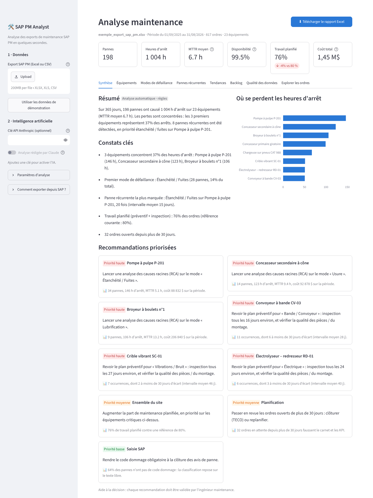
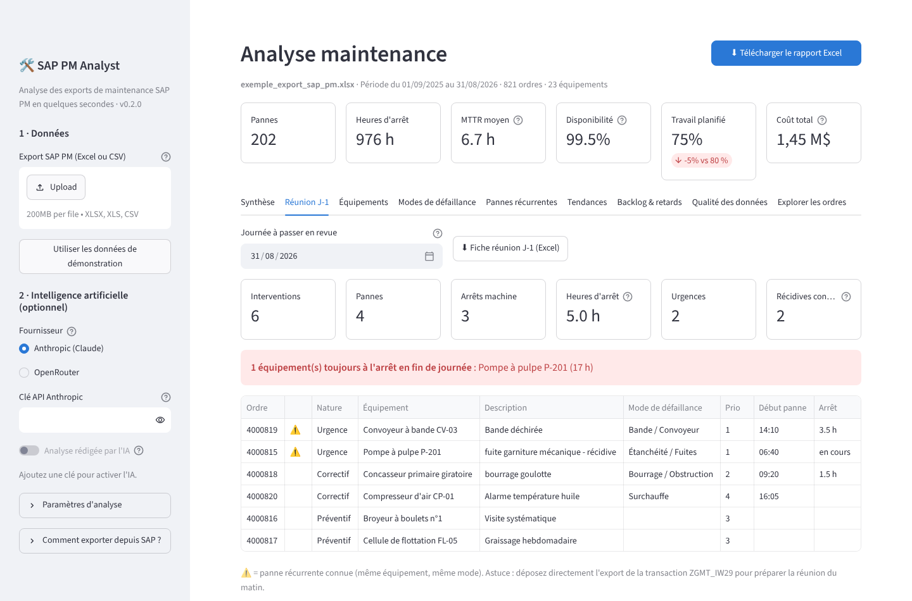
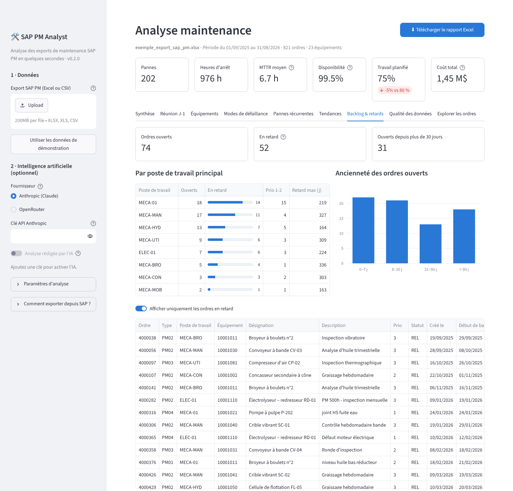
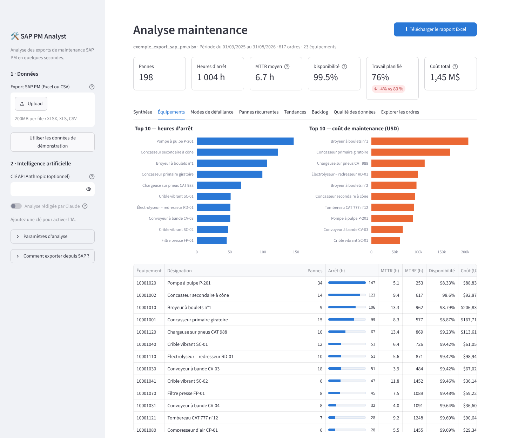
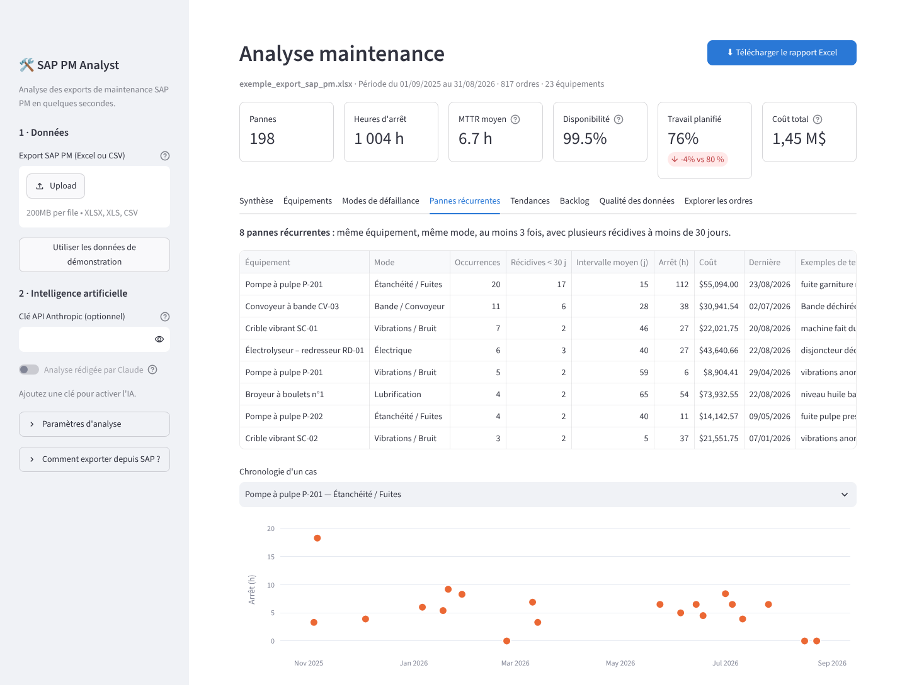
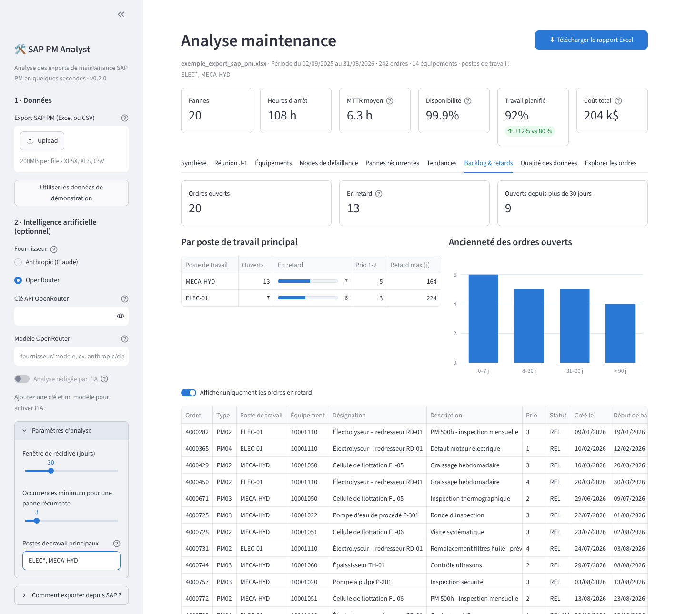
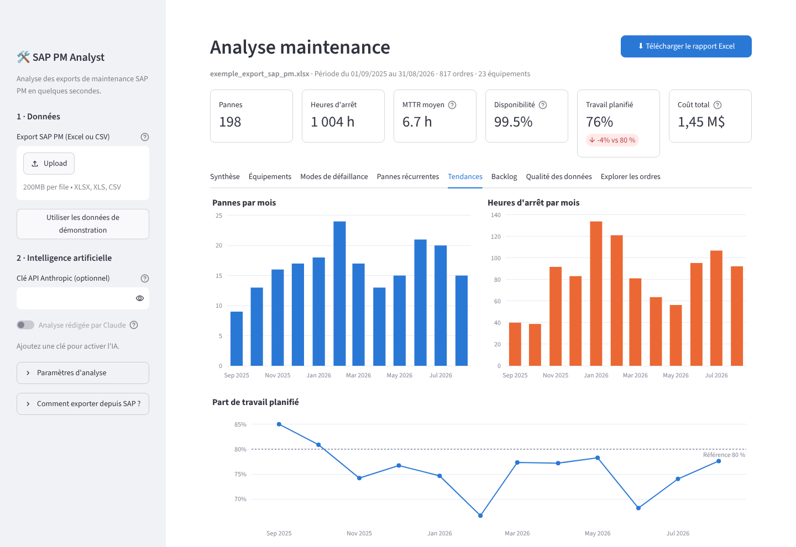

# 🛠️ SAP PM Analyst

**Hours of SAP PM interpretation, done in seconds.** Drop in a maintenance export from SAP PM and get the reliability KPIs, the machines and failures costing the most, recurring breakdowns, overdue orders per work centre, a ready-made brief for the morning operations meeting, a data-quality check, and prioritized recommendations. Everything also comes out as a professional Excel report ready to share.

> 🇫🇷 L'interface et le rapport sont en français. *Démarrage rapide en français plus bas.*
> **Current version: 0.2.0** — see the [CHANGELOG](CHANGELOG.md).



---

## What it does

| | |
|---|---|
| **Reads any SAP PM export** | Excel or CSV from **IW39/IW38** (orders), **IW29/IW28** (notifications) or the site transaction **ZGMT_IW29** (previous day's interventions). Column names in French, English or SAP technical codes (`AUFNR`, `EQUNR`, `GSTRP`, `AUSVN`…) are recognised automatically, whatever ALV layout was used. |
| **Calculates the KPIs** | Failures, downtime, **MTTR**, **MTBF**, availability, cost, planned vs. corrective work, per machine and site-wide. |
| **Morning meeting (J-1)** | One click gives the previous day's interventions, breakdowns, machines **still down**, and flags failures that are known recurrences. Printable one-page Excel sheet. |
| **Overdue orders** | Like IW39: an open order is late when its **basic start date** (*Bsc start*) has passed. Counted per **main work centre**, with SAP-style wildcard filtering (`MECA*`, `HC*`). |
| **Classifies free text** | Turns technicians' notes (`"rlt chauffe palier"`, `"fuite garniture"`, `"belt misalignment"`) into failure modes: bearings, seals/leaks, belts, electrical, hydraulic, wear, blockage… |
| **Finds what matters** | Bad actors (Pareto), recurring failures (same machine, same failure mode, repeatedly within 30 days), aged backlog. |
| **Recommends actions** | Prioritized actions (root-cause analysis, preventive-plan changes, backlog review per work centre, data-entry rules), each tied to the number that justifies it. |
| **Checks the data first** | Duplicates, missing damage codes, missing end dates, inverted dates, vague texts, with a 0–100 data-quality score. |
| **Excel report** | 9 formatted tabs. KPI cells are **live Excel formulas** pointing at the raw data, so every number can be traced back to the orders behind it. |

### Where the AI fits (and where it doesn't)

```
SAP PM export ─► clean & map ─► KPIs (Python, exact) ─► classify texts ─► analysis & recommendations ─► app + Excel
                                       ▲                 rules + AI model     rules or AI model
                                 never the AI
```

* **The numbers are always computed by code**, never by the language model.
* **AI is optional** and works with two providers:
  * **Anthropic** — Claude directly (`ANTHROPIC_API_KEY`).
  * **OpenRouter** — one key for hundreds of models: Claude, GPT, Gemini, Mistral, Llama… (`OPENROUTER_API_KEY`). The app lists the OpenRouter models that support structured JSON output, newest first.
* The model classifies the descriptions the keyword rules can't place, and writes the summary and recommendations from the computed numbers only.
* **Without an API key the tool still works fully**, using its built-in rule-based analysis.
* It is **read-only**: it never writes anything back into SAP. Recommendations are decision support, to be validated by the maintenance engineer.

---

## Quick start

**Easiest (Windows):** install [Python 3.10+](https://www.python.org/downloads/) (tick *"Add Python to PATH"*), then double-click **`lancer.bat`**. On macOS/Linux: `./lancer.sh`.

The app opens in your browser at http://localhost:8501. Click **"Essayer avec les données de démonstration"** to see it on a sample dataset, or drop your own export.

**Manual:**

```bash
pip install -r requirements.txt
streamlit run app.py
```

**Command line (no interface):**

```bash
python -m sapagent mon_export.xlsx -o rapport.xlsx                 # rule-based analysis
python -m sapagent mon_export.xlsx --j1                            # + one-page J-1 meeting sheet
python -m sapagent mon_export.xlsx --work-centers "MECA*,ELEC-01"  # only these main work centres
python -m sapagent mon_export.xlsx --ai                            # with Claude (ANTHROPIC_API_KEY)
python -m sapagent mon_export.xlsx --ai --provider openrouter --model anthropic/claude-sonnet-4.5
python -m sapagent --demo                                          # on the sample data
```

### Enabling the AI

| | Anthropic (Claude) | OpenRouter |
|---|---|---|
| Key | `ANTHROPIC_API_KEY` | `OPENROUTER_API_KEY` ([openrouter.ai/keys](https://openrouter.ai/keys)) |
| In the app | Sidebar → *Fournisseur : Anthropic* → paste the key | Sidebar → *Fournisseur : OpenRouter* → paste the key → pick a model |
| Default model | `claude-opus-5-5` | Newest Claude Opus available on OpenRouter |
| Other model | `SAPAGENT_MODEL` or `--model` | `SAPAGENT_MODEL` or `--model`, any id from [openrouter.ai/models](https://openrouter.ai/models) |

`SAPAGENT_PROVIDER=openrouter` makes OpenRouter the default on the command line (it is also picked automatically when only `OPENROUTER_API_KEY` is set). Models that support **structured outputs** give the most reliable results; for the others the tool falls back to plain JSON mode.

---

## 🇫🇷 Démarrage rapide

1. Installer [Python 3.10+](https://www.python.org/downloads/) (cocher *« Add Python to PATH »*).
2. Double-cliquer sur **`lancer.bat`** (Windows) ou lancer `./lancer.sh` (Mac/Linux).
3. Dans le navigateur, cliquer sur **« Essayer avec les données de démonstration »** ou déposer un export SAP PM.
4. Cliquer sur **« Télécharger le rapport Excel »**, ou ouvrir l'onglet **Réunion J-1** pour la fiche de la réunion du matin.

**Exporter depuis SAP :** voir le **[guide d'export SAP](docs/GUIDE_EXPORT_SAP.md)** (IW39 pas à pas, transactions utiles, liste des codes transaction du site).
En bref : **IW39** (ordres) ou **IW29** / **ZGMT_IW29** (avis) → statuts, poste de travail principal (joker `*` accepté), période → F8 → *Liste → Exporter → Tableur*.
Seuls trois éléments sont obligatoires : un **n° d'ordre ou d'avis**, l'**équipement** et **une date** ; plus il y a de colonnes, plus l'analyse est riche.

**IA (optionnel) :** dans la barre latérale, choisir **Anthropic** (clé Claude) ou **OpenRouter** (une clé pour Claude, GPT, Gemini, Mistral…), coller la clé, puis activer « Analyse rédigée par l'IA ».

---

## Screenshots

| Morning meeting (J-1) | Overdue orders per work centre |
|---|---|
|  |  |

| Equipment | Recurring failures |
|---|---|
|  |  |

| OpenRouter + work-centre filter | Trends |
|---|---|
|  |  |

Sample outputs: [`exemples/rapport_exemple.xlsx`](exemples/rapport_exemple.xlsx) (full report) and [`exemples/reunion_J-1_exemple.xlsx`](exemples/reunion_J-1_exemple.xlsx) (meeting sheet).

---

## Adapting to a real plant

Every plant configures SAP differently. These are the settings to check with the maintenance engineer, all in [`sapagent/schema.py`](sapagent/schema.py):

| Setting | Default | Where |
|---|---|---|
| Meaning of order types | `PM01` corrective, `PM02` preventive, `PM03` inspection, `PM04` emergency | `ORDER_TYPES` |
| Meaning of notification types | `M1` request, `M2` malfunction, `M3` activity report | `NOTIFICATION_TYPES` |
| Damage-code catalogue | Example codes (`ROUL`, `FUIT`, `BAND`…) | `DAMAGE_CODES` |
| Column names | French / English / technical SAP names | `COLUMNS` |
| Keywords per failure mode | French + English + shop-floor abbreviations | `KEYWORDS` in `sapagent/classifier.py` |
| Closed statuses | `TECO`, `CLSD`, `NOCO`… | `CLOSED_STATUSES` |

KPI definitions are listed in the report's **Méthode** tab.

---

## Project layout

```
app.py                  Web interface (Streamlit)
sapagent/
  loader.py             Reads CSV/Excel, recognises columns, cleans dates/numbers (orders or notifications)
  classifier.py         Free text → failure mode (SAP code, then keywords)
  kpis.py               All calculations (MTTR, MTBF, Pareto, recurring failures, backlog, overdue, J-1, data quality)
  insights.py           Rule-based findings & recommendations (offline)
  ai.py                 Optional AI layer — Anthropic or OpenRouter (classification + written analysis)
  report.py             Excel report and J-1 meeting sheet (xlsxwriter, live formulas)
  pipeline.py           Glues the steps together, work-centre filter
  sap_reference.py      SAP PM transactions useful for exports
  sample_data.py        Fictitious, realistic SAP PM export for demos/tests
docs/GUIDE_EXPORT_SAP.md  How to export from SAP (IW39 step by step, transaction codes)
data/                   Sample export (fictitious)
exemples/               Sample Excel outputs
tests/                  pytest suite
```

Run the tests: `pip install -r requirements-dev.txt && pytest`

---

## Status & next steps

**v0.2.0** — working MVP, validated on fictitious data that reproduces real SAP PM problems. The AI calls are covered by offline tests; run one live test with your own Anthropic or OpenRouter key before a demo.

1. **Get a real export** (IW39 over 6–12 months, and a ZGMT_IW29 of one day), anonymised if needed, and confirm with the engineer: order and notification types, damage-code catalogue, work-centre codes, and whether data may be sent to a cloud AI.
2. **Run it on that export** and have the engineer check every number and recommendation.
3. **Tune** keywords, codes and thresholds to the plant, then prepare the before/after demo (time spent today vs. with the tool).
4. Next data sources (see the export guide): **IW49N** (operations, workload per work centre), **IP24 / ZGMT_IP24** (preventive plan compliance), **IK17** (measurement documents, for condition monitoring).
5. Later: direct SAP connection (OData/BAPI, needs IT approval), scheduled reports, alerts.

> **Data confidentiality:** never commit real company data to this repository. The `donnees_reelles/` folder is git-ignored for that purpose. With the AI enabled, only the computed KPIs (site-wide, per machine and per work centre) and the free-text descriptions are sent to the chosen AI provider (Anthropic, or OpenRouter and the model's host), never the full export.

*The sample data (plant, equipment numbers, texts) is entirely fictitious.*
