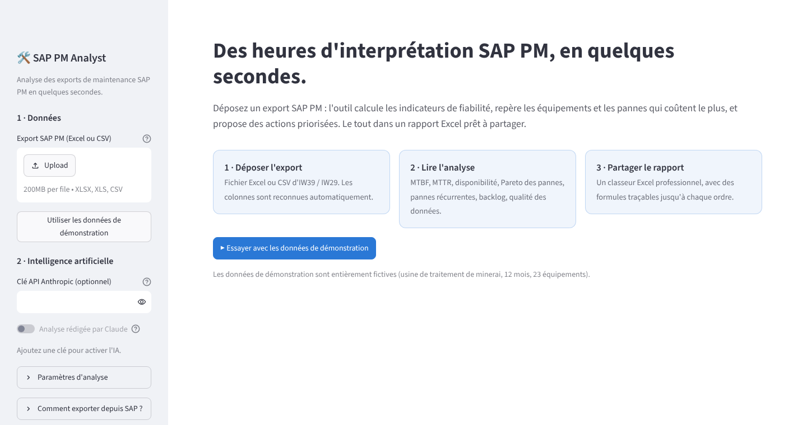

# 🛠️ SAP PM Analyst

**Hours of SAP PM interpretation, done in seconds.** Drop in a maintenance export from SAP PM and get the reliability KPIs, the machines and failures costing the most, recurring breakdowns, the backlog, a data-quality check, and prioritized recommendations. Everything also comes out as a professional Excel report ready to share.

> 🇫🇷 L'interface et le rapport sont en français. *Démarrage rapide en français plus bas.*


---

## What it does

| | |
|---|---|
| **Reads any SAP PM export** | Excel or CSV from IW39/IW38 (orders) or IW29/IW28 (notifications). Column names in French, English or SAP technical codes (`AUFNR`, `EQUNR`, `AUSVN`…) are recognised automatically, whatever ALV layout was used. |
| **Calculates the KPIs** | Failures, downtime, **MTTR**, **MTBF**, availability, cost, planned vs. corrective work, open backlog and its age, per machine and site-wide. |
| **Classifies free text** | Turns technicians' notes (`"rlt chauffe palier"`, `"fuite garniture"`, `"belt misalignment"`) into failure modes: bearings, seals/leaks, belts, electrical, hydraulic, wear, blockage… |
| **Finds what matters** | Bad actors (Pareto), recurring failures (same machine, same failure mode, repeatedly within 30 days), aged backlog. |
| **Recommends actions** | Prioritized actions (root-cause analysis, preventive-plan changes, backlog clean-up, data-entry rules), each tied to the number that justifies it. |
| **Checks the data first** | Duplicates, missing damage codes, missing end dates, inverted dates, vague texts, with a 0–100 data-quality score. |
| **Excel report** | 9 formatted tabs. KPI cells are **live Excel formulas** pointing at the raw data, so every number can be traced back to the orders behind it. |

### Where the AI fits (and where it doesn't)

```
SAP PM export ─► clean & map ─► KPIs (Python, exact) ─► classify texts ─► analysis & recommendations ─► app + Excel
                                       ▲                    rules + Claude      rules or Claude
                                 never the AI
```

* **The numbers are always computed by code**, never by the language model.
* **Claude (optional)** classifies the descriptions the keyword rules can't place, and writes the summary and recommendations from the computed numbers only.
* **Without an API key the tool still works fully**, using its built-in rule-based analysis.
* It is **read-only**: it never writes anything back into SAP. Recommendations are decision support, to be validated by the maintenance engineer.

---

## Quick start

**Easiest (Windows):** install [Python 3.10+](https://www.python.org/downloads/) (tick *"Add Python to PATH"*), then double-click **`lancer.bat`**. On macOS/Linux: `./lancer.sh`.

The app opens in your browser at http://localhost:8501. Click **"Essayer avec les données de démonstration"** to see it on a sample dataset, or drop your own export.

**Manual:**

```bash
pip install -r requirements.txt
streamlit run app.py
```

**Command line (no interface):**

```bash
python -m sapagent mon_export.xlsx -o rapport.xlsx      # rule-based analysis
python -m sapagent mon_export.xlsx --ai                 # with Claude (needs ANTHROPIC_API_KEY)
python -m sapagent --demo                               # on the sample data
```

**Enable the AI:** paste an Anthropic API key in the sidebar, or set the `ANTHROPIC_API_KEY` environment variable. The model can be changed with `SAPAGENT_MODEL` (default `claude-opus-5-5`).

---

## 🇫🇷 Démarrage rapide

1. Installer [Python 3.10+](https://www.python.org/downloads/) (cocher *« Add Python to PATH »*).
2. Double-cliquer sur **`lancer.bat`** (Windows) ou lancer `./lancer.sh` (Mac/Linux).
3. Dans le navigateur, cliquer sur **« Essayer avec les données de démonstration »** ou déposer un export SAP PM.
4. Cliquer sur **« Télécharger le rapport Excel »**.

**Exporter depuis SAP :** transaction **IW39** (ordres) ou **IW29** (avis) → choisir la période → *Liste → Exporter → Tableur*.
Colonnes utiles : équipement, désignation, type d'ordre, description, date de création, début / fin de panne, arrêt machine, statut système, coûts réels, code dommage. Seuls le **n° d'ordre**, l'**équipement** et la **date** sont obligatoires ; plus il y a de colonnes, plus l'analyse est riche.

---

## Screenshots

| Equipment | Recurring failures |
|---|---|
|  |  |

| Home | Trends |
|---|---|
|  |  |

A sample Excel output is in [`exemples/rapport_exemple.xlsx`](exemples/rapport_exemple.xlsx).

---

## Adapting to a real plant

Every plant configures SAP differently. These are the settings to check with the maintenance engineer, all in [`sapagent/schema.py`](sapagent/schema.py):

| Setting | Default | Where |
|---|---|---|
| Meaning of order types | `PM01` corrective, `PM02` preventive, `PM03` inspection, `PM04` emergency | `ORDER_TYPES` |
| Damage-code catalogue | Example codes (`ROUL`, `FUIT`, `BAND`…) | `DAMAGE_CODES` |
| Column names | French / English / technical SAP names | `COLUMNS` |
| Keywords per failure mode | French + English + shop-floor abbreviations | `KEYWORDS` in `sapagent/classifier.py` |
| Closed statuses | `TECO`, `CLSD`… | `CLOSED_STATUSES` |

KPI definitions are listed in the report's **Méthode** tab.

---

## Project layout

```
app.py                  Web interface (Streamlit)
sapagent/
  loader.py             Reads CSV/Excel, recognises columns, cleans dates/numbers
  classifier.py         Free text → failure mode (SAP code, then keywords)
  kpis.py               All calculations (MTTR, MTBF, Pareto, recurring failures, backlog, data quality)
  insights.py           Rule-based findings & recommendations (offline)
  ai.py                 Optional Claude layer (classification + written analysis)
  report.py             Excel report (xlsxwriter, live formulas)
  pipeline.py           Glues the steps together
  sample_data.py        Fictitious, realistic SAP PM export for demos/tests
data/                   Sample export (fictitious)
exemples/               Sample Excel report
tests/                  pytest suite
```

Run the tests: `pip install -r requirements-dev.txt && pytest`

---

## Status & next steps

This is a **working MVP (Phase 1)**, validated on fictitious data that reproduces real SAP PM problems.

1. **Get a real export** (anonymised if needed) and confirm with the engineer: order types, damage-code catalogue, columns available, and whether data may be sent to a cloud AI.
2. **Run it on that export** and have the engineer check every number and recommendation.
3. **Tune** keywords, codes and thresholds to the plant, then prepare the before/after demo (time spent today vs. with the tool).
4. Later: direct SAP connection (OData/BAPI, needs IT approval), scheduled reports, alerts.

> **Data confidentiality:** never commit real company data to this repository. The `donnees_reelles/` folder is git-ignored for that purpose. With the AI enabled, only the computed KPIs (site-wide and per machine) and the free-text descriptions are sent to the Anthropic API, never the full export.

*The sample data (plant, equipment numbers, texts) is entirely fictitious.*
